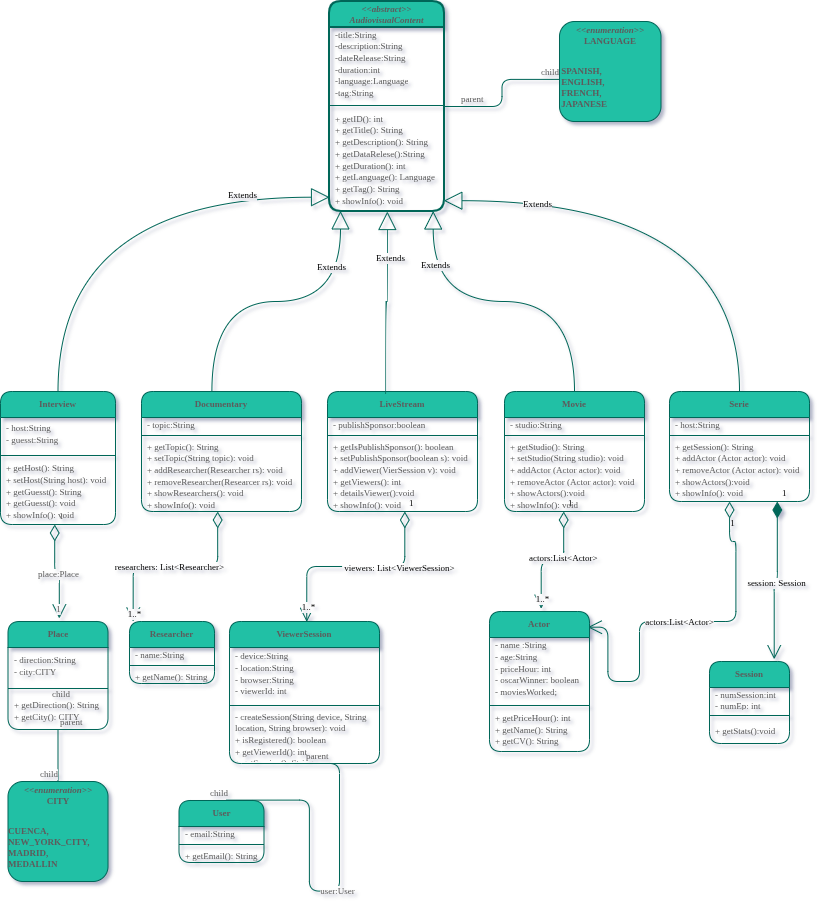

# Audiovisual Content Management System

An object-oriented Java project focused on modeling audiovisual content and implementing relationships between classes using Object-Oriented Programming (OOP) principles.

This project extends an existing audiovisual content management system by introducing new subclasses, resource classes, and different types of relationships, including association, aggregation, and composition.

## General Objective

To extend and improve an existing Java application by applying advanced Object-Oriented Programming concepts, particularly inheritance, association, aggregation, and composition, while developing a functional system that demonstrates how different classes interact with each other.

## Specific Objectives

- Implement inheritance through new subclasses of the abstract `AudiovisualContent` class.
- Apply association, aggregation, and composition to represent relationships between objects.
- Improve code organization, encapsulation, and reusability.
- Develop a functional system capable of creating and manipulating different audiovisual content objects.
- Implement end-to-end tests to verify the system's behavior and class relationships.
- Manage the project using Git and GitHub.

## Features Added

### **Subclasses:**

- Interview
- LiveStream

These classes extend the abstract `AudiovisualContent` class, inheriting its common attributes and behaviors while introducing their own specific characteristics and functionality.

### **Resources:**

- Actor (**Aggregation**)
- Researcher (**Aggregation**)
- Session (**Composition**)

These classes represent additional resources associated with audiovisual content.

- **Actor:** Represents actors associated with audiovisual productions.
- **Researcher:** Represents researchers who participate in documentary productions.
- **Session:** Represents sessions that belong to their corresponding audiovisual content.

## Relationship Between Classes

The project implements three types of relationships:

- **Association:** A structural relationship between independent classes that interact with each other.
- **Aggregation:** A weak whole-part relationship in which the contained objects can exist independently of the container.
- **Composition:** A strong whole-part relationship in which the contained objects depend on the lifecycle of their owner.

### UML Class Diagram



The diagram illustrates the class structure, inheritance hierarchy, attributes, methods, and relationships implemented throughout the project.

## Testing

End-to-end (E2E) testing was incorporated to verify the system's behavior and ensure that the implemented class relationships work as expected.

The tests aim to:

- Verify object creation and manipulation.
- Check the behavior of the audiovisual content classes.
- Validate interactions between related objects.
- Detect potential errors in the implemented logic.

## Installation

### Prerequisites

- Java Development Kit (JDK 11 or later).
- Git.

### Clone the repository

```bash
git clone https://github.com/4s3rn4m3/contenido_audiovisuales.git
```

### Navigate to the source directory

```bash
cd contenido_audiovisuales/src
```

### Run the application

```bash
java main/Main.java
```

## Project Structure

```text
contenido_audiovisuales/
│
├── src/
│   ├── main/
│   │   └── Main.java
│   └── ...
│
├── img/
│   └── relation.png
│
├── README.md
└── .gitignore
```

## Technologies Used

- **Java:** Main programming language.
- **Object-Oriented Programming:** Inheritance, encapsulation, abstraction, and class relationships.
- **UML:** Class diagram modeling.
- **Git:** Version control.
- **GitHub:** Repository management and project collaboration.

## References

- [Secure Unique ID Generation in Java](https://www.javathinking.com/blog/how-to-generate-unique-id-in-java-integer/#3-method-1-cryptographically-secure-random-integers-securerandom)
- [Abstract Classes in Java](https://www.ciberaula.com/cursos/java/clases_abstractas.php#que-son)
- [Relationships Between Classes – GeeksforGeeks](https://www.geeksforgeeks.org/relationships-between-classes-in-java/)

---

## Academic Context

- **Institution:** Universidad Politécnica Salesiana
- **Subject:** Object-Oriented Programming
- **Unit:** Unit 2 – Relationships Between Classes
- **Assignment:** Task #1 – Audiovisual Content Expansion

**Author:** 4s3rn4m3

**Repository:** [contenido_audiovisuales](https://github.com/4s3rn4m3/contenido_audiovisuales)
